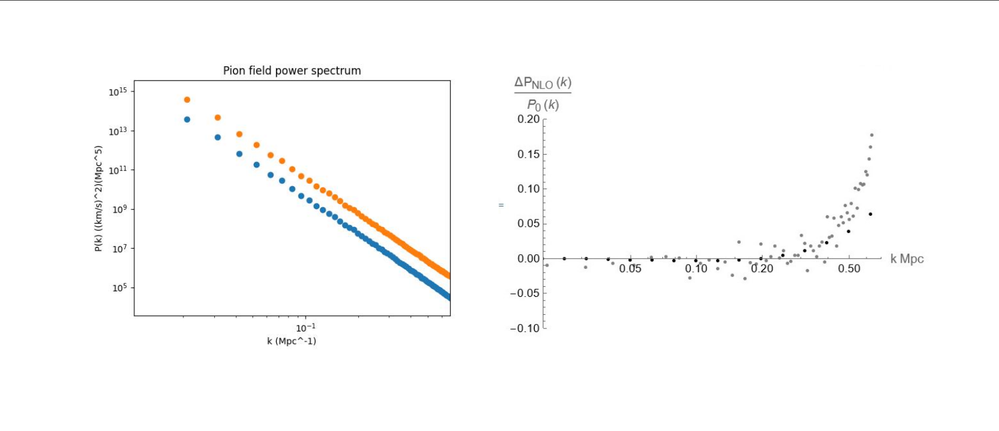
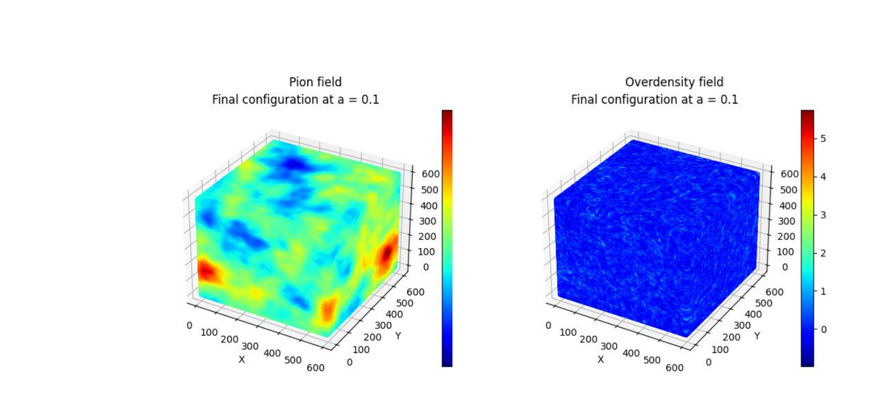

## Portfolio page for my work on the paper and Links to Paper and Code
Effective field theory of a single scalar pion field for large-scale structure: paper summary and links.

#### "Effective field theory of a single scalar pion field for large scale structure in the Universe"
(Celik, Horn, Mishra & Muqattash, 2026) — [arXiv:2604.12009](https://arxiv.org/abs/2604.12009)

The simulation code (PLASTIC) was written by Bart Horn and me (© 2026 Bart Horn and Bhavya Mishra). The latest version lives in a single canonical location:
- [bhorn9/pion_lss_code](https://github.com/bhorn9/pion_lss_code)
This repo links to it instead of duplicating it, so the code and its history stay in one place.
It summarizes the project and my part in it.

## The paper in brief

We describe the effective field theory of large-scale structure using a single scalar degree of
freedom: the velocity potential of the matter fluid in a ΛCDM universe. This cosmic "pion" field
is nonlinearly related to the overdensity and the gravitational potential, and is the Goldstone
boson of spontaneously broken spacetime symmetry. That lets perturbation theory be organized
systematically while keeping the symmetries manifest.

- Develops the pion-field EFT to next-to-leading order.
- Computes corrections to the power spectrum and checks them against the consistency
  relations of spontaneously broken spacetime symmetry.
- Compares the results with simulations of structure evolution in the pion-field picture.
- Uses N-body simulations to measure EFT coefficients and study additional degrees of freedom
  in the deep nonlinear regime.
- Discusses how the pion-field picture could suggest new variables for analyzing simulations and
  surveys of large-scale structure.

## My contribution

Co-author of the paper and co-owner & coder of the simulation code (shared code authorship and copyright with my advisor, Dr. Bart Horn). 

My main focus was developing the FFT-based simulation and mapping code, taking it from a Mathematica prototype to Python to a C++ implementation, and improving its runtime.

- Replaced Green's-function Laplacian inversion (O(N⁶)) with FFT-based spectral inversion (O(N³ log N)) in the 3D simulation.
- Implemented a custom mixed-radix (2, 3, 5) Cooley–Tukey FFT in C++, removing the power-of-2 grid-size constraint and the need to flatten 3D arrays for  FFTW. Its runtime is comparable to NumPy and FFTW.
- Reduced runtime by roughly 400× from the first Mathematica prototype (about 20× from the move to Python, and about 20× from the move to C++), and added multithreading across independent FFT slices.

The specific implementation and the benchmarks are documented in my honors thesis (Manhattan University, 2025). can be accessed via this link:

## Code

Simulation code (`PLASTIC.py`, `PLASTIC++.cpp`, `Gaussian_ICs.py`, `Plots.py`) can be found at => [bhorn9/pion_lss_code](https://github.com/bhorn9/pion_lss_code)

The code is free to use for research and educational purposes. Please see that repository's README and LICENSE, and cite the paper if you use it.
## Figures

*Left: The evolution of the pion field power spectrum with box size = 600 Mpc, N = 128, Ωm0 = 0.31, for a = 0.01 (blue) and a = 0.10 (orange). Right: Fractional corrections to the power spectrum from nonlinear collapse. Black = analytic prediction
at NLO, Gray = numerical simulation Figure from Celik et al. (2026).*

*Evolved conditions for π and δ at a = 0.1. Boxsize = 600 Mpc, N = 128, Ωm = 0.31 and H0 = 68 km/s/Mpc*

#### For more such cool images and simulation description check out our paper at: https://arxiv.org/astro-ph-CO/2604.12009
#### Citation

"Effective Field Theory of a single Scalar Pion Field for Large Scale Structure," Lara Celik, Bart Horn, Bhavya Mishra and David Muqattash, https://arxiv.org/astro-ph-CO/2604.12009

## Credits

- Bart Horn — research advisor; co-author of the paper and co-author of the simulation code
- Bhavya Mishra — co-author of the paper and co-principal coder of the simulation code
- Lara Celik, David Muqattash — co-authors of the paper; additional input and testing on the code
- Eamon McShane — additional input and testing on the code
- Supported in part by the National Science Foundation's Research at Undergraduate Institutions (RUI) program under grant PHY-2210475, and by the Kakos School of Arts and Sciences Summer Research Scholars Program.

## My Conference Talks

- "Cosmological Field Simulation" — Honors Thesis Defense, Science Seminar, Manhattan University, April 2025
- "Mapping the Universe's Growth" — Cosmic Pathways 2025, City College of New York, New York, 2025
- "Mapping the Universe's Growth" — Manhattan University Summer Research Conference, Riverdale, NY, September 2024
- "Simulating Large-Scale Structure Evolution with Soft-Pion Inspired Fluid Description" — 42nd RSPS Zone 2 Conference, University of Rochester, NY, April 2024
- "Pion Description for Large-Scale Structure in the Universe" — Manhattan University Summer Research Symposium, Riverdale, NY, September 2023
- "Modeling Large-Scale Structure Evolution Using Cosmological Pion Simulations" — 41st RSPS Zone 2 Conference, University of Rochester, NY, April 2023
- "Early Universe Simulation: Large-Scale Structure as Pressure-less Pion Fluid" — Jasper Summer Research Symposium, Manhattan University, NY, October 2022
